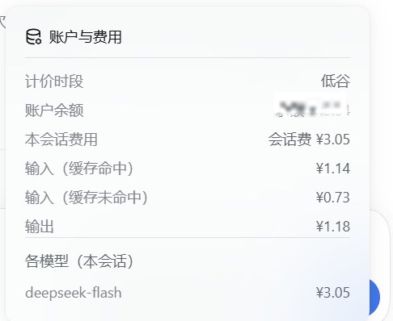

# dsh-cost

**Account balance** and **per-session cost** pill for the [DeepSeek Harness](https://github.com/deepseek-ai/deepseek-harness) Web GUI. It adds one more pill to the composer's stats row, next to the built-in clock and token pills — billing period dot · balance · session cost — and opens a breakdown when clicked. The cost side needs no credentials; the balance side needs a DeepSeek API key.

> Community plugin. Not affiliated with, endorsed by, or shipped by DeepSeek.

## Screenshots




## Features

- **Pill** in the `conversation.composer.dock` slot (`id: cost-stats`, `order: 1`), on the same row as the official clock and token pills. The period reads `Peak` or `Off-peak`, matching the plugin's own dictionaries.
- **Popup breakdown**: billing period, account balance, current session cost, and the cost split by bucket — cache-hit input / cache-miss input (cache writes included) / output — plus a per-model breakdown whenever the host can fold one.
- **Official pricing**: the 2026-09-10 price cut and the pro→flash routing are both modelled. While the session is attached, usage is folded per request, so a session spanning a price change, a routing change or a peak boundary never mixes two rate tables.
- **Works without an API key**: the billing period and the session cost still render; only the balance segment is missing.
- **No credentials stored**: the key is used in-process only and never written to disk.
- Positioning and dismiss behaviour reuse the official `ui-primitives` helpers (`useAnchoredPosition`, `useDismissOnOutsidePointer`).

## Requirements

- DeepSeek Harness (dsh) `>= 0.2.0-rc.2`.
- A DeepSeek **API key** if you want the balance. It is resolved through dsh's credentials seam; the plugin falls back to the `DEEPSEEK_API_KEY` environment variable **only when the credentials service itself is unavailable** — if credentials exists but holds no such key, the environment variable is not consulted. When no key resolves (for example an install signed in with a DeepSeek *account*), the pill keeps showing the billing period and the session cost, and only the balance is absent.

## Install

From the plugin market (search `dsh-cost`), or from a terminal:

```sh
dsh plugin --profile <profile> add github:Arun1016/dsh-cost
```

> **Install it with the `github:` spec above.** An unrelated plugin by a different
> author is published on npm under the bare name `dsh-cost`; `dsh plugin add dsh-cost`
> would install that one instead of this one.

## Configuration

```yaml
- id: cost-stats
  name: dsh-cost
  config:
    holidays: ['2026-01-01']   # statutory holidays bill off-peak all day
```

`holidays` is the only Config field. It defaults to the built-in 2026 PRC statutory-holiday table (State Council notice 国办发明电〔2025〕7号), as Beijing-local `YYYY-MM-DD` dates. A new year is a Config edit, not a code change.

## Billing model

Prices are CNY per million tokens, and every figure below is a **peak** rate — off-peak is exactly half, per the official rule.

| Item | Rule |
|---|---|
| Flash (from 2026-09-10 12:00 Beijing) | peak `2 / 0.04 / 8` = uncached input / cache-hit input / output |
| Flash (before the price cut) | `3.0 / 0.1 / 9.0`, same three buckets |
| Pro (`deepseek-v4-pro`, before 2026-09-14 12:00 Beijing) | `9.0 / 0.3 / 27.0`, same three buckets |
| Peak window | workdays `09:00–12:00` and `14:00–18:00` |
| Off-peak | everything else; weekends and statutory holidays all day, including a weekend that holiday adjustment turns into a workday |
| Clock used | the local clock of the machine running dsh — the official windows are Beijing time, so the reading is only exact on a Beijing-time host |
| pro→flash routing | billed as Flash from 2026-09-14 12:00 Beijing |
| `inputTokens` | uncached input; cache writes bill at the uncached rate |
| reasoning | subset of output, not billed separately |

## Privacy

- No telemetry, no analytics, no third-party endpoints.
- The only outbound request is `https://api.deepseek.com/user/balance`, authenticated with your key; it times out after 15 s.
- The browser half only reads the host route `/api/dsh-balance` — once per session step, plus a 60 s poll. It never contacts a third-party endpoint itself.
- This plugin never writes the key to disk, and balances are cached in memory only.

## Known limitations

- While the session is attached the host folds usage per request, so a span across the price cut, the routing change or a peak boundary keeps its own rate table. A **detached** session is priced by the host as one aggregate at the current Flash rates and carries **no** estimate marker; the browser half's own fallback estimate uses the same current rates and is marked `(估)` in Chinese / `(est)` in English.
- Every reading is conditional: a missing balance hides only that segment; a cost of exactly `¥0.00` hides the cost segment; and when the host route is missing or errors, the whole pill disappears silently, with no placeholder and no error message. After a failure it stops per-step polling and keeps only the 60 s poll.
- Amounts always print with a `¥` prefix, regardless of the account currency the API reports. Balance uses 2 decimals; costs use 2 decimals, or 4 below `¥0.01`.
- The per-model breakdown appears only when the host can fold the session by model, and model ids are normalised (for example `deepseek-v4-flash` and `deepseek-v4-flash-vision-exp` both display as `deepseek-flash`).
- Balance failures are silent: no key, an invalid key, a network error and the 15 s timeout all produce a `200` response with no `balance_infos` field, and that empty result is cached for 30 s as well.
- The balance cache is process-wide and shared across sessions; it is only invalidated by a different key, so a top-up can take up to 30 s to appear.
- Model ids the plugin does not recognise are priced with the Flash table.
- Costs accumulate per request, so rounding may differ from the account ledger.
- Events without a model source or usage are skipped.
- The popup has no height cap and does not share the official pills' mutual-exclusion state, so it can stay open alongside another popup.
- The built-in holiday table covers 2026 only.

## Development

Source lives in `src/` (host half `index.ts`, client half `client/`). It is built with the official dsh monorepo toolchain: `tsconfig.*.json` and `tsdown.config.ts` reference the monorepo through relative paths (`../../../tsconfig.base.json`, `../../client/tsdown.client.ts`), so building requires placing this package back into that tree — the repository cannot be built standalone.

The published package carries `lib/` and `cordis.patch.yml`, plus `package.json`, both READMEs and `LICENSE` (npm always includes those).

## License

MIT — see [LICENSE](LICENSE).
