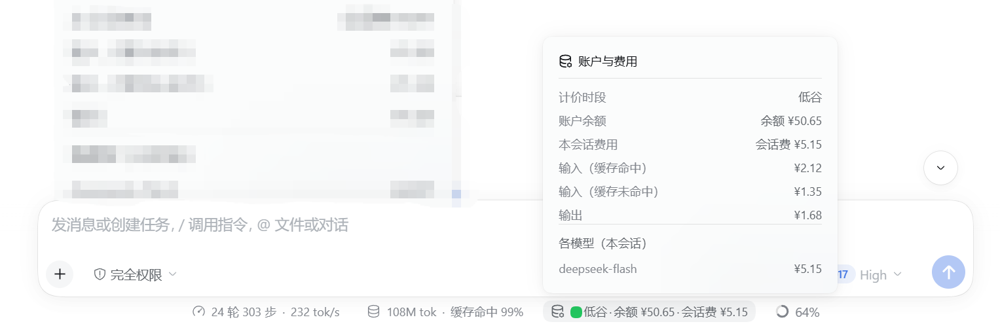

# dsh-cost

DeepSeek Harness 的**账户余额及费用统计**胶囊。它在会话输入框下方的官方统计行右侧新增一枚胶囊，集成三样信息：计费时段（高峰 / 低谷，用颜色区分）、账户余额、本次会话费用；点击展开可查看本次会话的详细费用统计——缓存命中输入、缓存未命中输入、输出三项金额，按模型拆分的花费，本会话网页搜索与网页抓取的成功调用次数和调用费（2026-11-01 起按次计费），以及由本会话派生的子代理会话（含多级）的 token 与网页调用费用。费用部分不需要任何凭据；余额部分需要一个 DeepSeek API key。

> 社区插件，与 DeepSeek 官方无隶属关系，也不由官方随包分发。

## 截图




## 功能

- **统计行最右侧的胶囊**：以 `order: 2` 注册到 `conversation.composer.dock`，排在官方两颗统计胶囊（`activity` = 0、`usage` = 1）之后。时段显示为「高峰」或「低谷」，并用红 / 绿圆点区分。
- **明细弹窗**：显示计费时段、账户余额、本次会话费用，以及按三项拆分的金额——缓存命中输入、缓存未命中输入（含缓存写入）、输出；宿主能按模型折算时，还会列出各模型的费用；会话发生过网页搜索 / 抓取时，再列出两者的成功调用次数与调用费；会话派生过子代理时，再列出“其中子代理（N 个会话）”的费用。
- **子代理费用并入本会话**：按会话头部的 `origin: subagent` 血缘找到本会话派生的全部后代子代理（含子代理再派生的子代理），把它们的 token 用量与网页调用费一并折算；用户手动 fork 出来的会话是独立对话，不计入。仍在运行的子代理直接读内存日志，已结束的通过会话查询服务读持久化日志（带缓存）。
- **与官方一致的计费口径**：内置 2026-09-10 降价与 pro→flash 路由。会话处于挂载状态时逐请求折算，跨越降价、路由切换或高峰边界的用量各自沿用当时的价目表，不会混用两套费率。网页搜索 / 抓取的调用费按官方 2026-10-17 公告计入：每 1,000 次成功请求 5 元（每次 0.005 元），失败、无结果、超时不收费，自北京时间 2026-11-01 00:00 起对 DeepSeek Harness 的服务端工具调用计费；插件按调用落地时刻折算，免费期内的调用显示为「免费」。
- **高峰 / 低谷判定**：工作日 `9:00–12:00`、`14:00–18:00` 为高峰；其余时间、周末与法定节假日全天为低谷（含调休成为工作日的周末）。内建的 2026 年法定节假日表可通过 `Config.holidays` 替换。
- **费率跟随官方调价**：费率表内置于插件，随插件版本更新以跟随官方调价。
- **没有 API key 也能用**：只用 DeepSeek 账户登录的用户照样能看到计费时段与会话费用，只是不显示余额。
- **不保存凭据**：API key 通过 dsh 的凭据服务（credentials seam）解析，只在进程内使用，不写入磁盘。
- **中英双语**：`cost-stats` 命名空间下 19 条词条，中文与英文各一套，随应用语言切换。
- **只读宿主路由**：浏览器端只请求宿主的 `/api/dsh-balance`（每个会话步一次，另有 60 秒轮询），不访问任何第三方接口。
- **无本地状态**：不持久化任何数据，卸载后无残留。
- **原生交互**：弹窗定位与点击外部关闭复用官方 `ui-primitives` 的 `useAnchoredPosition` 与 `useDismissOnOutsidePointer`。

## 运行要求

- DeepSeek Harness（dsh）`>= 0.2.1-rc.2`。
- 想看到**账户余额**，需要一个能被 dsh 凭据服务解析到的 DeepSeek **API key**（`DEEPSEEK_API_KEY`，或经 dsh credentials 配置）。只有当凭据服务本身不可用时，插件才回退读 `DEEPSEEK_API_KEY` 环境变量；凭据服务存在但里面没有这个 key 时，不会去读环境变量。解析不到 key 时（例如只用 DeepSeek 账户登录、没配 API key），胶囊仍显示计费时段与会话费用，只是不显示余额。

## 安装

在插件市场搜索 `dsh-cost` 一键安装，或在终端执行：

```sh
dsh plugin --profile <profile> add dsh-cost-pill
```

也可以从 GitHub 源码安装：`dsh plugin --profile <profile> add github:Arun1016/dsh-cost`。

> 注意：npm 上的裸名 `dsh-cost` 属于另一个无关项目；本插件发布在 `@arun_1016/` 作用域下，不会装错。

## 配置

```yaml
- id: cost-stats
  name: dsh-cost
  config:
    holidays: ['2026-01-01']   # 法定节假日全天按低谷计价
```

`holidays` 是本插件唯一的配置项。默认值为内建的 2026 年法定节假日表（来源：国办发明电〔2025〕7 号），日期采用北京本地日历的 `YYYY-MM-DD` 格式；跨年只需修改配置，不必改代码。

## 计费模型

模型价格单位为**元 / 百万 token**，表中每个数字都是**高峰**价——按官方规则，低谷恰好是高峰的一半；网页搜索 / 抓取按请求次数计价，单独列在表尾。

| 项 | 规则 |
|---|---|
| Flash（2026-09-10 12:00 北京时间起） | 高峰 `2 / 0.04 / 8`，依次为未命中输入 / 缓存命中输入 / 输出 |
| Flash（降价前） | `3.0 / 0.1 / 9.0`，同样三个口径 |
| Pro（`deepseek-v4-pro`，2026-09-14 12:00 北京时间之前） | `9.0 / 0.3 / 27.0`，同样三个口径 |
| 高峰时段 | 工作日 `9:00–12:00`、`14:00–18:00` |
| 低谷（官方文档亦称空闲时段） | 其余时间；周末与法定节假日全天，包括调休成为工作日的那个周末 |
| 判定所用时钟 | 运行 dsh 那台机器的本地时钟——官方时段以北京时间为准，因此在非北京时区的主机上读数不精确 |
| pro→flash 路由 | 2026-09-14 12:00（北京时间）起按 Flash 计价 |
| `inputTokens` | 指未命中输入；缓存写入也按未命中价计费 |
| reasoning | 属于输出子集，不另计 |
| Search / Fetch 调用 | 每 1,000 次成功请求 5 元（¥0.005 / 次），不区分高峰低谷 |
| 网页计费起始 | 北京时间 2026-11-01 00:00；更早的成功调用记 0 元（界面显示「免费」） |
| 网页成功判定 | Search 的 `results` 非空；Fetch 返回网页正文；失败、无结果、超时不收费 |
| 调用计数依据 | 会话日志里的 `web_search` / `web_fetch` 工具调用；一次多关键词的 `web_search` 按去重后的关键词数计 |
| 计算范围 | 本会话自有事件（排除 fork 继承的前缀）+ 本会话派生的全部后代子代理的自有事件 |
| 子代理识别 | 会话头部 `origin: subagent` 的血缘后代（含多级）；用户手动 fork 的独立会话不计入 |

网页搜索 / 抓取的价格与计费起始来自官方[价格页](https://api-docs.deepseek.com/zh-cn/quick_start/pricing)与[网页搜索与抓取指南](https://api-docs.deepseek.com/zh-cn/guides/search)（公告日期 2026-10-17）。

## 隐私

- 无遥测、无统计、不访问第三方接口。
- 唯一的外部请求是 `https://api.deepseek.com/user/balance`，用你的 key 认证，超时时间 15 秒。
- 浏览器端只读取宿主的 `/api/dsh-balance`（每个会话步一次，另有 60 秒轮询），自身不访问任何第三方接口。
- 本插件不把 key 写入磁盘；余额只在内存中缓存。

## 已知限制

- **会话挂载时**，宿主按请求逐一折算，跨越降价、路由切换或高峰边界的用量各自保留当时价目；**未挂载的会话**由宿主按当下 Flash 价目对聚合用量一次性计价，且不带估算标记；浏览器端自己的兜底估算同样使用当下价目，中文标 `(估)`、英文标 `(est)`。
- 网页搜索 / 抓取只能从会话日志的 `web_search` / `web_fetch` 工具调用推断：宿主不加载未挂载会话的日志，也不保留每个关键词各自的返回，因此**未挂载会话**与**本地兜底估算**都不含这部分；日志被压缩裁剪后同样会少计。
- 一次多关键词的 `web_search` 若只有部分关键词返回结果，无法从合并后的结果里区分哪个关键词为空，插件会按全部去重关键词计费（偏多）；失败的调用整体不计费，但同一批并发请求中已经成功的兄弟请求无法计入（偏少）。
- 网页调用费按工具结果落地时刻计价；恰好跨越北京时间 2026-11-01 00:00 计费起点的请求，归属可能有秒级误差。
- 子代理费用依赖 dsh 的会话查询服务（`sessionQuery`）：该服务不可用时只统计仍在内存中的子代理；已结束并被释放的子代理会少计。
- 已结束的子代理通过持久化日志读取并按会话 id 缓存（上限 256 条）；日志无法读取（格式迁移、损坏）时该子代理不计入。
- 仍在运行的子代理逐次读取内存日志；如果某个子代理在两次费用轮询之间结束并被释放，最后一次增量可能滞后一个轮询周期。
- 会话记录里 fork 继承的前缀不计入本会话费用（它已由父会话计过）；用户手动 fork 的会话是独立对话，也不计入。
- 插件按工具名统计，不区分底层搜索 / 抓取提供方：当前 profile 使用 DeepSeek 的 Search / Fetch API，计费口径才对得上；若换成其他提供方，插件仍会把调用计入（会把未计费调用显示成已计费）。
- 各段读数都是条件渲染：没有余额时只隐藏余额段；费用恰好为 `¥0.00` 时隐藏费用段；**宿主路由缺失或报错时，整颗胶囊静默消失**，没有占位也没有错误提示，失败后不再按步重试，只保留 60 秒轮询。
- 金额一律以 `¥` 前缀显示，不随接口返回的账户币种变化。余额固定 2 位小数；会话费用为 2 位小数，低于 `¥0.01` 时改用 4 位；网页搜索 / 抓取调用费固定 3 位小数（¥0.005 的整数倍，3 次调用显示 `¥0.015` 而非两位小数的 `¥0.01`）。
- 逐模型明细只在宿主能按模型折算时出现；模型名会归一化（例如 `deepseek-v4-flash` 与 `deepseek-v4-flash-vision-exp` 都显示为 `deepseek-flash`）。
- 余额失败是静默的：未配置 key、key 无效、网络错误、15 秒超时，都会返回 `200` 且不含 `balance_infos` 字段，而这个空结果同样会被缓存 30 秒。
- 余额缓存是进程级、跨会话共享的，只有换了 key 才失效，因此刚充值后最多滞后 30 秒才会反映出来。
- 插件不认识的模型 id 一律按 Flash 价目计价。
- 按请求累加，与账户账单之间可能存在分位舍入差。
- 事件里缺少 model source 或 usage 时，跳过该步的 token 计价；网页调用由独立的事件折算。
- 弹窗没有高度上限，也不与官方胶囊共享互斥开合状态，可能和另一个弹窗同时开着。
- 内建节假日表只覆盖 2026 年。

## 开发

源码在 `src/`（宿主端 `index.ts`，浏览器端 `client/`）。它沿用官方 dsh monorepo 工具链构建：`tsconfig.*.json` 与 `tsdown.config.ts` 通过相对路径引用 monorepo（`../../../tsconfig.base.json`、`../../client/tsdown.client.ts`），因此构建时需要把这个包放回那棵目录树，**仓库本身无法独立构建**。

发布包含 `lib/` 与 `cordis.patch.yml`，以及 `package.json`、两份 README 与 `LICENSE`（后几项 npm 总会带上）。

## 许可证

MIT，见 [LICENSE](LICENSE)。
